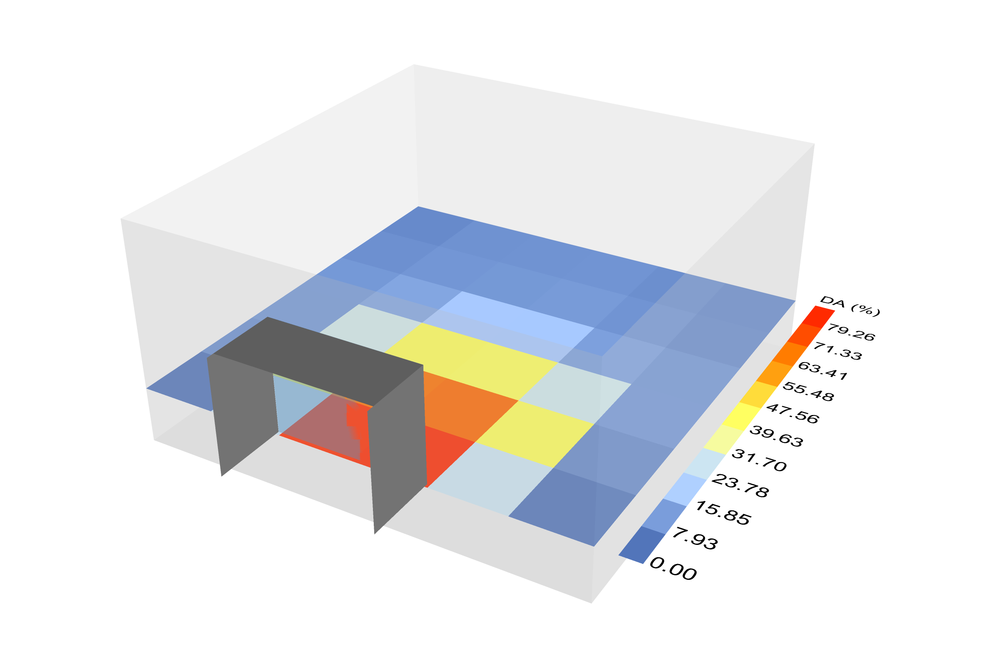
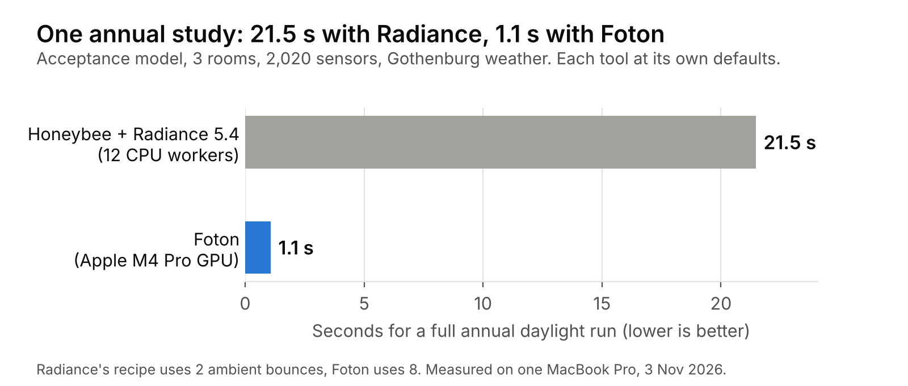

# Foton

**Annual daylight results for Honeybee models in about a second, on your
computer's GPU.**

[](https://pypi.org/project/foton-daylight/)
[](https://pypi.org/project/foton-daylight/)
[](https://github.com/snjsomnath/foton/actions/workflows/ci.yml)
[](https://github.com/snjsomnath/foton/blob/main/LICENSE)

Foton computes daylight autonomy (DA), useful daylight illuminance (UDI),
spatial daylight autonomy (sDA) and daylight factor for Honeybee models. It
does the expensive ray tracing on the GPU, so a study that takes Radiance tens
of seconds finishes in about one. You keep your Honeybee model and your
Ladybug result components. Only the slow step changes.

<p align="center"></p>

*The shipped Grasshopper example. Foton computes a year of daylight in about a
second, and Honeybee and Ladybug read the result as if Radiance had written it.*

## Who it is for

- **Teachers and students** who want daylight results to update while they
  move a wall, a window or a shading fin.
- **Designers** comparing many early options, where waiting minutes per run
  means testing fewer ideas.
- **Researchers** who need thousands of annual runs for a parameter study.

## At a glance

<p align="center"></p>

<p align="center"></p>

On a typical room Foton's daylight autonomy is within 0.2 percentage points of
converged Radiance. Details are under [Accuracy](#accuracy) and
[Speed](#speed) below.

## Quick start

```bash
pip install "foton-daylight[honeybee]"
```

That is all an annual study needs: from version 0.3.2, Radiance does not have
to be installed.

```python
from foton.honeybee import run_annual_daylight

run = run_annual_daylight(
    model="my_building.hbjson",   # any Honeybee model with sensor grids
    wea="my_city.epw",            # any EnergyPlus weather file
    output_folder="foton-results",
)

for grid in run.grids:
    print(f"{grid.identifier}: sDA {grid.sda:.0f} %, mean DA {grid.da.mean():.0f} %")
```

The `foton-results` folder has the same layout as a Honeybee annual daylight
run, so Honeybee's own metric and visualisation components can read it. To
check which GPU Foton will use, run `foton-honeybee capabilities`.

**In Rhino 8 and Grasshopper:** download `foton-grasshopper-<version>.zip` from
the [releases page](https://github.com/snjsomnath/foton/releases) and follow
the [Grasshopper quickstart](https://github.com/snjsomnath/foton/blob/main/docs/grasshopper-quickstart.md).
It takes about five minutes.

## How it works


Foton uses the same daylight-coefficient method as Radiance's matrix workflow.
It traces, once, how much light from each patch of the sky reaches each
sensor. It then combines those coefficients with the 8,760 hourly skies of a
weather file. Foton does both steps on the GPU: Metal on Apple silicon, Vulkan
on Windows and Linux. A slower CPU version gives the same answer on any
machine. More in [architecture](https://github.com/snjsomnath/foton/blob/main/docs/architecture.md).

## Accuracy

Foton is checked against Radiance 5.4a on 106 test models, each at two sky
resolutions: 212 cases with 234 sensor grids. The Radiance results are
repeated with more rays until they stop changing, so they serve as the correct
answer. Metal and Vulkan give the same figures to two decimal places.

| Compared with Radiance | Typical grid (median) | 95 % of grids within |
| --- | ---: | ---: |
| Daylight reaching the sensors from the sky, total difference | 0.5 % | 1.2 % |
| Annual hourly illuminance, total difference | 0.1 % | 0.6 % |
| Annual hourly illuminance, hour-by-hour scatter (CV(RMSE)) | 2.4 % | 7.1 % |
| Daylight autonomy (DA), average error per grid | 0.2 pp | 0.5 pp |
| Useful daylight illuminance (UDI), average error per grid | 0.2 pp | 0.6 pp |
| Spatial daylight autonomy (sDA) | 0 pp | 2.8 pp (one sensor in 36) |

pp means percentage points. 204 of the 212 cases pass every check. The eight
that don't are rooms lit only through glass from another room, plus one very
bright deep room where Radiance itself changes by 3.6 % between 8 and 12
bounces. They are explained in the
[accuracy notes](https://github.com/snjsomnath/foton/blob/main/docs/purpose-and-plan.md).
Raw results:
[Metal](https://github.com/snjsomnath/foton/blob/main/validation/results/2026-11-03-architectural-v4-metal-0.3.0-release/README.md),
[Vulkan](https://github.com/snjsomnath/foton/blob/main/validation/results/2026-11-03-architectural-v4-vulkan-t4/README.md).

## Speed

Measured on 3 November 2026 on a MacBook Pro with an Apple M4 Pro (24 GB),
using Metal and Foton's default `final` quality (8 bounces, 146-patch sky,
Gothenburg weather). Each time is a full annual run on a model Foton had not
seen before: loading the model, building the GPU scene, tracing, and writing
DA and UDI for all 8,760 hours. Median of five runs.

| Model | Rooms | Sensors | Annual run |
| --- | ---: | ---: | ---: |
| Teaching office | 1 | 96 | 0.14 s |
| Courtyard with four rooms | 4 | 112 | 0.17 s |
| Acceptance model | 3 | 2,020 | 1.07 s |
| Four-storey office block | 256 | 9,216 | 5.77 s |

On the acceptance model, Honeybee's standard annual daylight recipe took 21.5 s
on the same Mac, using Radiance 5.4 with 12 workers. Each tool ran at its own
defaults, and the Honeybee recipe uses 2 light bounces where Foton uses 8.
Treat this as one fair-minded comparison, not a promise of a fixed speed-up.
The full timing data is in the
[benchmark run](https://github.com/snjsomnath/foton/blob/main/benchmarks/results/20261103T195604Z-CM-GHHXPN239T/benchmark.md).

Inside Grasshopper a run also writes the model, starts Foton and reads the
results back. That round trip took 0.49 s for the teaching office and 1.37 s
for the acceptance model
([breakdown](https://github.com/snjsomnath/foton/blob/main/benchmarks/results/20261103T195642Z-grasshopper/benchmark.md)).
On an NVIDIA Tesla T4 with Vulkan, a small model takes about 1.5 s against
0.25 s on the M4 Pro.

## What it does

- Annual DA, continuous DA, UDI (low, useful, high) and sDA, plus daylight factor
- Hourly illuminance for every sensor, in Honeybee's result format
- Its own annual sky model (Perez all-weather), so Radiance is not needed
- Diffuse surfaces with several light bounces, thin glass, and shading devices
- 146-patch (Tregenza) and 578-patch (Reinhart) skies
- `preview` and `final` quality settings
- Metal (macOS), Vulkan (Windows, Linux) and a CPU fallback that gives the
  same answer
- A Python API, a command-line tool and three Grasshopper components

## What it does not do

Foton covers ordinary architectural daylighting: matte surfaces, ordinary
glazing, shading devices and building-scale sensor grids. Use Radiance for:

- glossy or mirror-like materials, and other Radiance material types
- complex fenestration (BSDF), prismatic films and other light-redirecting systems
- glare, annual sunlight exposure (ASE) and dynamic shading
- certification or compliance reports

One known difference: Foton treats the sun as part of its sky patch, as
Radiance's `rfluxmtx` method does, rather than tracing it as a separate disc.
On south-facing rooms in Phoenix, Seattle and Gothenburg this changed DA by
about 1 percentage point
([measured](https://github.com/snjsomnath/foton/blob/main/validation/results/2026-11-02-teaching-sun-vs-stock/README.md)).

## Documentation

- [Installation](https://github.com/snjsomnath/foton/blob/main/docs/installation.md): supported GPUs and platforms
- [Grasshopper quickstart](https://github.com/snjsomnath/foton/blob/main/docs/grasshopper-quickstart.md)
- [Python API](https://github.com/snjsomnath/foton/blob/main/docs/python-api.md)
- [How it works](https://github.com/snjsomnath/foton/blob/main/docs/architecture.md)
- [Accuracy notes and plan](https://github.com/snjsomnath/foton/blob/main/docs/purpose-and-plan.md)
- [Reproducing the benchmarks](https://github.com/snjsomnath/foton/blob/main/docs/benchmarking.md)
- [Validation models](https://github.com/snjsomnath/foton/blob/main/validation/architectural-scenes.md)
- [FAQ](https://github.com/snjsomnath/foton/blob/main/docs/faq.md)
- [Changelog](https://github.com/snjsomnath/foton/blob/main/CHANGELOG.md)

### Live teaching demo

A clone of this repository also includes a one-minute animated teaching demo
that runs live on your GPU. It needs Node.js 20 or newer:

```bash
pip install -e ".[viewer]"
cd viewer && npm ci && npm run dev:demo
```

Then open `http://127.0.0.1:5173/demo.html`. See the
[demo guide](https://github.com/snjsomnath/foton/blob/main/viewer/src/demo/README.md).

## Status

Foton is young (version 0.3) and still changing. The accuracy figures above
hold for the kinds of rooms in the test set. They are not a claim that Foton
matches Radiance on any model. Please
[open an issue](https://github.com/snjsomnath/foton/issues) if you find a model
where the two disagree.

## How this was built

This project is basically an exercise in using LLMs to create
reimplementations within a tight scope against a deterministic target. In
this case, we wanted to have fast GPU based daylighting calculations for
teaching purposes, so we built it! (or asked an LLM to). The code and
documentation were generated by an LLM. Radiance served as the deterministic
target: every result above comes from comparing Foton with it.

## Citing Foton

If you use Foton in research, please cite it. GitHub's **Cite this repository**
button gives the reference, from
[CITATION.cff](https://github.com/snjsomnath/foton/blob/main/CITATION.cff).

## License and credits

Foton is released under the
[MIT License](https://github.com/snjsomnath/foton/blob/main/LICENSE).
[NOTICE](https://github.com/snjsomnath/foton/blob/main/NOTICE) credits the
published methods and data it builds on, and
[THIRD_PARTY_LICENSES.md](https://github.com/snjsomnath/foton/blob/main/THIRD_PARTY_LICENSES.md)
lists the open-source libraries inside the Python package.

Foton works alongside [Ladybug Tools](https://www.ladybug.tools/) and is tested
against [Radiance](https://www.radiance-online.org/). It is not affiliated with
either project. The optional Honeybee packages are licensed separately under
AGPL-3.0 and GPL-3.0, and Foton does not include their code.

## Author

Foton is written and maintained by
[Sanjay Somanath](https://github.com/snjsomnath) at Chalmers University of
Technology.
