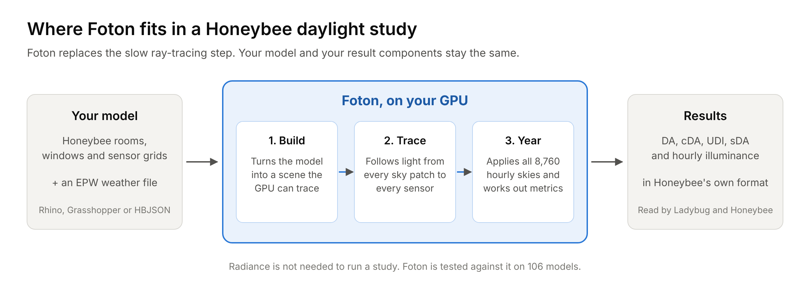

# How Foton works

## The method in plain words

Annual daylight metrics need the illuminance at every sensor for every hour of
the year. Tracing light separately for 8,760 hours would be slow, so Foton
uses the daylight-coefficient method, the same one behind Radiance's matrix
workflow:

1. **Divide the sky into patches.** 146 patches (Tregenza) by default, or 578
   (Reinhart) for more detail. Patch 0 is the ground.
2. **Trace once.** For each sensor, Foton follows light from each sky patch
   into the room, through glass and across up to eight bounces off walls,
   floors and ceilings. The result is a table of coefficients: how much each
   patch contributes to each sensor. This is the expensive step, and it runs
   on the GPU.
3. **Apply the year.** Foton turns the weather file into 8,760 hourly skies
   with its own Perez all-weather model. Multiplying the coefficients by each
   hour's sky gives the hourly illuminance. The GPU also counts the hours
   above each threshold, so DA, UDI and sDA come out without storing the
   whole hour-by-sensor table.

Because the coefficients do not depend on the weather, changing the weather
file, schedule or thresholds reuses them and costs almost nothing.

## Where things live

| Folder | What it holds |
| --- | --- |
| `crates/daylight-core` | The engine's shared parts in Rust: scene geometry, materials, sky patches and the Perez sky model, sampling, metrics, and the job and backend interfaces. |
| `crates/daylight-metal` | The Metal backend for Apple GPUs, and the CPU reference backend that gives the same answer without a GPU. |
| `crates/daylight-vulkan` | The Vulkan backend for NVIDIA, AMD and Intel GPUs on Windows and Linux. |
| `crates/daylight-python` | The bridge that exposes the engine to Python as `daylight_engine._native`. |
| `crates/daylight-cli` | A small command-line tool for testing the engine on a generated room. |
| `python/daylight_engine` | The Python package: the engine API, the Honeybee integration (`honeybee/`) and the local viewer service (`viewer/`). |
| `python/foton` | The public import name. `foton`, `foton.honeybee` and `foton.viewer` re-export `daylight_engine`. |
| `python/honeybee_foton` | The client that Grasshopper uses to run `foton-honeybee` as a separate process. |
| `python/foton_bridge` | Small helpers shared with the Grasshopper components. They also run on IronPython 2.7. |
| `grasshopper_foton` | The Grasshopper component scripts and the packaged example. |
| `viewer` | The browser viewer and the teaching demo (React and three.js). |
| `validation` | The test models, the Radiance comparison and the archived results. |
| `scripts` | Benchmarks, validation runs, packaging and release checks. |

Why several Python package names? `daylight_engine` was the project's first
name and is still where the code lives. `foton` is the name to use in your own
code. A future release may merge them, with a deprecation period first.

## Reference: data contracts

The rest of this page is for people working on the engine itself.

## Status

The repository implements backend-neutral scene, sampling, material, sky, metric,
job, and Python contracts. It also contains:

- A deterministic CPU transport backend used for fixtures and correctness work.
- Native Metal device discovery and runtime MSL compilation through `objc2-metal`.
- Vulkan 1.3 device discovery and build-time GLSL-to-SPIR-V compilation.
- Resident Metal and Vulkan BLAS/TLAS resources keyed by scene handle and revision.
- GPU direct-visibility, thin-glass, and progressive diffuse ray-query transport.
- GPU annual `DC × sky` threshold reduction without allocating `[sensor, timestep]`.
- Matching MSL and GLSL contracts for direct visibility, progressive diffuse
  transport, coefficient finalization, and annual metrics.

## Coordinate and Array Contract

- Metres, right-handed, `+Z` up, `+Y` north, and `+X` east.
- Transforms are row-major `float32[I,4,4]`.
- Vertices and sensors are `float32[N,3]`.
- Triangles and indices are `uint32`.
- Inputs must be C-contiguous. Python borrows are validated and copied into
  engine-owned memory before an asynchronous job starts.
- Rust `Vec3`, sensor, coefficient, and sky buffers map to MSL `packed_float3` and
  Vulkan scalar-block-layout `vec3` fields with matching 12-byte strides.
- Stable sensor and room IDs never depend on dispatch order.

## Sky Contract

- Row `0` is ground.
- Tregenza has 146 rows including ground.
- Reinhart MF:2 has 578 rows including ground.
- Sky matrices are patch-major `float32[patch,timestep,3]`.
- Coefficients are sensor-major `float32[sensor,patch,3]`.
- Final accumulation is MF:2; Tregenza preview coefficients are exact parent sums.
- RGB is preserved until the photopic conversion
  `[47.435, 119.93, 11.635]`.

## Metal Identity

TLAS descriptors and the separate instance-metadata buffer use the same
deterministic instance ordering. Baseline runtime-compiled MSL therefore uses
`intersection_result.instance_id` as the metadata index. User-ID descriptors also
populate `userID` with that index for language levels that expose custom user IDs,
but correctness does not depend on the unavailable `user_instance_id` result
field. The Metal mask remains a category bitmask (`opaque`, `glazing`, `exterior`,
`active batch`) and never stores room identity.

## Vulkan Identity

Vulkan BLASes retain reusable mesh-local geometry and the TLAS custom instance index
matches the separate metadata buffer. The eight-bit TLAS mask stores broad category
bits only. Auto-selection accepts hardware NVIDIA, AMD, and Intel devices exposing
buffer device address, scalar block layout, acceleration structures, and ray query;
CPU Vulkan implementations are rejected.

## Metrics

Occupancy is an explicit `float32[timestep]` weight array. GPU reduction retains only
occupied weight and above-threshold weight per sensor. Room sDA is area-weighted.
Results are labeled `static_sDA300_50`; this is a validated static metric and not a
claim of complete LM-83 certification.

## Lifetime and Export

`Engine.create_scene` commits an engine-owned scene handle. GPU acceleration
structures remain resident across analyses and are rebuilt when instance updates
advance the scene revision. Analysis workers own their request data, observe
cooperative cancellation between bounded GPU tiles, and are joined on result or
drop. Coefficient matrices remain internal unless `export_coefficients=True`.
