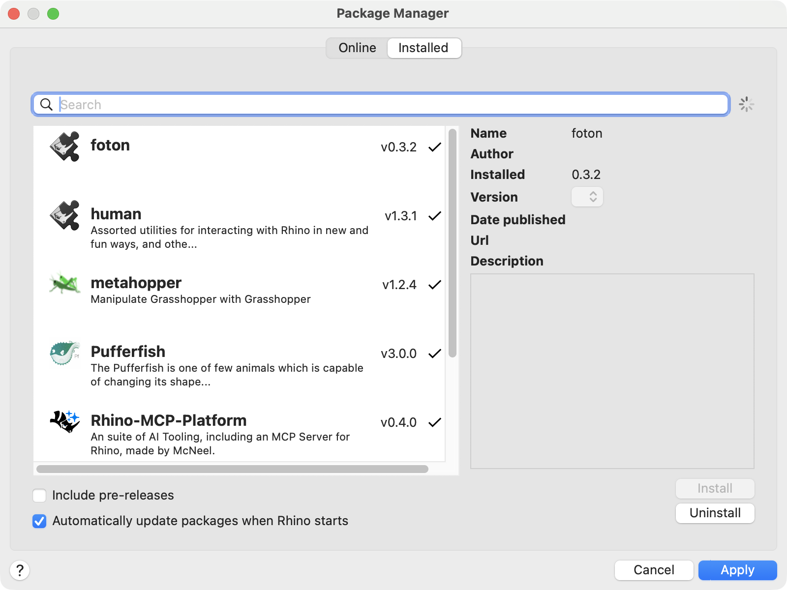
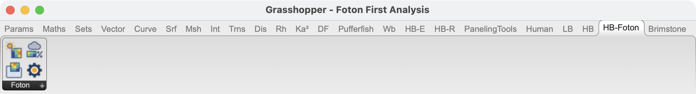
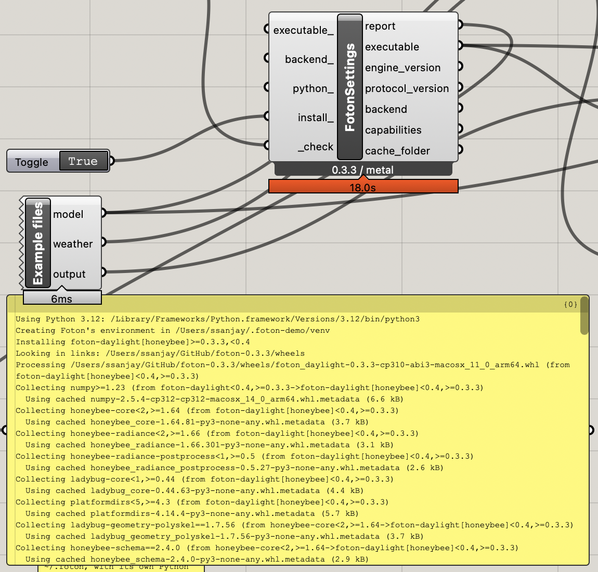
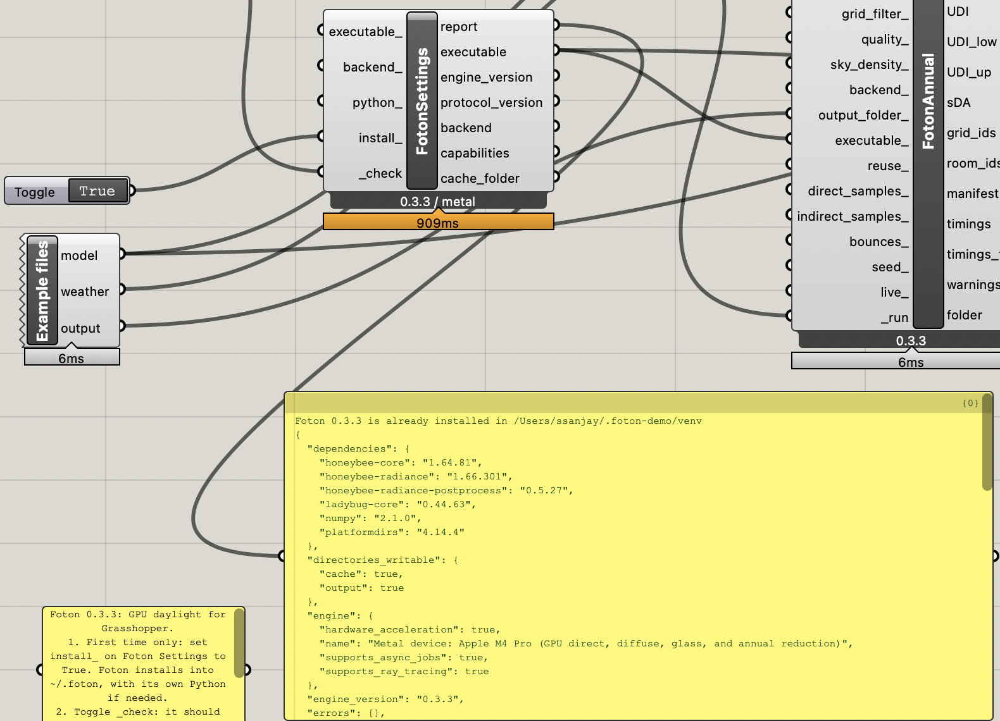
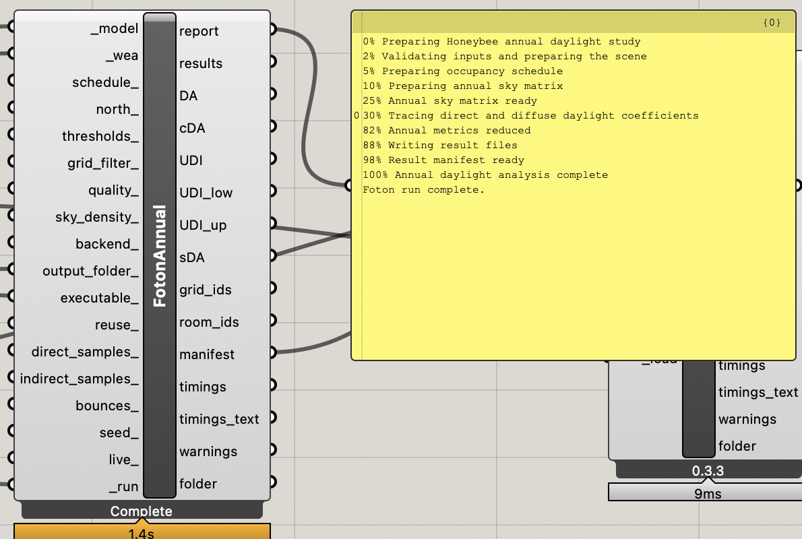
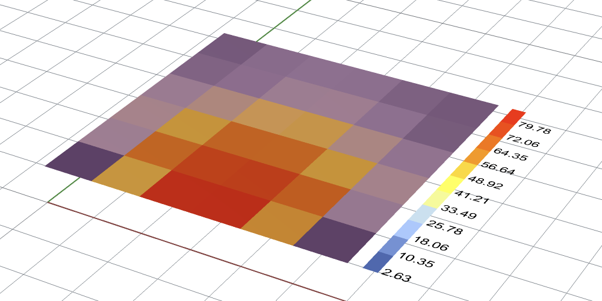

# First Foton analysis in Rhino 8

Foton is a public beta in preparation. Only hardware and scenes with published
passing release evidence should be described as validated.

## Install once

### What you need

- **Rhino 8** on a Mac or a Windows PC, with
  [Ladybug Tools](https://www.food4rhino.com/en/app/ladybug-tools) for the
  Honeybee model components.
- **A GPU Foton can use.** On a Mac: any Apple silicon Mac (M1 or later). On
  Windows: an NVIDIA RTX, AMD Radeon RX 6000 or newer, or Intel Arc graphics card
  with a current driver. Other computers fall back to a slow CPU mode that is only
  meant for checking problems.
- **An internet connection** for the first install.

You don't need to install Python or Radiance. If you already have Python 3.10
to 3.13, Foton uses it; if not, it downloads its own copy into a `.foton`
folder in your home folder.

### Step 1: get the Foton components

**A. From Rhino's Package Manager (recommended, once Foton is listed)**

1. In Rhino, type `PackageManager` and press Enter.
2. Search for **foton**, select it and click **Install**.
3. Restart Rhino. The Installed tab now shows **foton**:

   

The package also contains the example definition. You can find it in Rhino's
packages folder, under `foton/<version>/Foton First Analysis.gh`.

**B. From the release download**

1. Download `foton-grasshopper-<version>.zip` from the
   [latest release](https://github.com/snjsomnath/foton/releases/latest).
2. Unzip the whole archive into a folder you will keep. Keep the `examples`
   folder next to `Foton First Analysis.gh`.
3. Copy the four `.ghuser` files into Grasshopper's User Objects folder. In
   Grasshopper, choose **File > Special Folders > User Object Folder** to open
   it, then restart Rhino.

### Step 2: find the components

The four components sit together on the **HB-Foton** tab of the Grasshopper
toolbar. You can also double-click an empty part of the canvas and type
**Foton**. Hover over any input or output to read what
it does and what it defaults to. The number under each component is its Foton
version.

In 0.3.2 and earlier the components were hidden from the toolbar and from
canvas search. If you are on one of those, open **Foton First Analysis.gh** and
copy the components from it, or update.

### Step 3: let Foton Settings install the rest

1. Open **Foton First Analysis.gh** in Grasshopper.
2. Set the `install_` toggle on **Foton Settings** to True. Foton Settings makes
   Foton's own environment in a `.foton` folder in your home folder and
   downloads Foton into it. If there is no Python 3.10 to 3.13 on the computer,
   it first downloads a small installer called [uv](https://docs.astral.sh/uv/),
   which fetches a private copy of Python into the same folder. Nothing outside
   `.foton` changes. It shows each step as it goes. This happens once and takes
   a minute or two.

   

3. Set `_check` to True. The report shows the Foton version and the GPU it will
   use. It should say **Metal** on a Mac or **Vulkan** on Windows, not CPU.

   

If you want Foton to use a particular Python, connect its full path to
`python_`. If you would rather install Foton yourself, run
`python -m pip install "foton-daylight[honeybee]"`; Foton Settings finds it in
the usual places. To start again from scratch, delete the `.foton` folder.

### Step 4: run the example

Set `_run` on **Foton Annual Daylight** to True. The first run also prepares the
weather data, so it takes a little longer than later runs.

Connect `results` to **HB Annual Daylight Metrics** and its `DA` output, with the
room's sensor grid mesh, to **LB Spatial Heatmap** to see the result in Rhino:

The download is built in Rhino from the same component sources as the release
and checked before it is published.

## Five-minute example

1. Toggle **Check** on Foton Settings. Confirm the version, protocol, and selected
   backend. If Foton is not found, set `install_` to True, or connect the full
   `foton-honeybee` path to `executable_`.
2. Read any setup warnings. Metal or Vulkan should be selected for GPU execution.
   CPU reference fallback is usable for diagnosis but does not demonstrate GPU performance.
3. Toggle **Run** on Foton Annual Daylight. The example contains a shaded shoebox
   and Gothenburg weather. First-run weather preparation can take longer than later runs.
4. Connect `results` to **HB Annual Daylight Metrics**. Pair the original Honeybee
   SensorGrid meshes with `DA` in **LB Spatial Heatmap**; branches preserve model order.
5. Save the result folder. **Foton Annual Results** reloads its `run_manifest.json`
   without running a simulation. New result folders can be moved as a unit.

The canvas above is the shipped example plus the two Ladybug Tools components
from step 4 and three Custom Preview components for the room; Honeybee's own
metrics component returns the same DA as Foton's `DA` output because Foton
writes a standard annual-daylight results folder.

Use `quality_ = final` when evaluating accuracy; it is the preset the
[0.3.0 release evidence](release-readiness.md#tested-platforms-for-030)
validated against converged Radiance. Preview is visibly labelled. Changing
inputs, quality defaults, solver versions, backend, or sky model version invalidates
automatic reuse. Missing/corrupt metric files also cause a new run in a numbered folder.

## Live mode for sliders

Set `live_` to True on **Foton Annual Daylight** or **Foton Daylight Factor** when you
want to drag a slider and see results straight away. Foton then keeps running in the
background between runs, with the model, the GPU and the traced daylight
coefficients ready.

- Changing thresholds, the schedule or the weather reuses the traced coefficients, so
  only the metrics are recomputed.
- Changing geometry, the grid filter or the trace settings traces again, but skips
  starting Foton and loading its libraries.
- Live runs write no files, so `results` is empty and Honeybee's result components
  have nothing to read. Turn `live_` off and run again to save a results folder.
- Press ESC to stop a long live run. This also stops the background process; the next
  live run starts a new one.

The background process stops when Rhino closes.

## Daylight factor

**Foton Daylight Factor** needs only a Honeybee model. It returns the daylight factor
for each sensor under a CIE overcast sky, in one branch per SensorGrid, ready for
**LB Spatial Heatmap**. A saved run writes Honeybee's daylight-factor layout: one
`.res` file per grid with `grids_info.json`.

Daylight factor and annual daylight use the same traced coefficients. In live mode,
running one after the other on the same model and settings traces only once.

## Troubleshooting

| Symptom | Action |
| --- | --- |
| Executable not found | Set `install_` to True on Settings, or connect the full path to `executable_`. |
| Install can't download uv or Python | Check the internet connection (a proxy may block github.com). Or install Python 3.10 to 3.13 from python.org and set `install_` again, or connect a `python` executable to `python_`. |
| Components missing from the toolbar | You're on 0.3.2 or earlier: update, or copy the components from **Foton First Analysis.gh**. |
| Live run is no faster | The first live run starts Foton and traces as usual; only later runs on the same model are fast. |
| Settings reports `gendaymtx` unavailable | Nothing to do: annual runs use Foton's built-in sky. Install Radiance 5.4a and set `RADIANCE_BIN` only to reproduce validation evidence or to opt into `gendaymtx`. |
| Reference CPU selected | Update the GPU driver and inspect backend requirements; explicit Metal/Vulkan requests report errors instead of falling back. |
| Output/cache not writable | Use a local writable output folder and inspect Settings' directory diagnostics. |
| Unsupported modifier | Use diffuse Plastic or thin Glass with refractive index 1.52; Foton reports the rejected object/modifier. |
| Cancelled or failed | Read `report`; partial output is never eligible for reuse. Retry into the automatically allocated new folder. |

Report problems with Foton Settings output, OS/Rhino/GPU versions, the error text,
and a minimal shareable model. Remove private project paths from diagnostics before posting.
