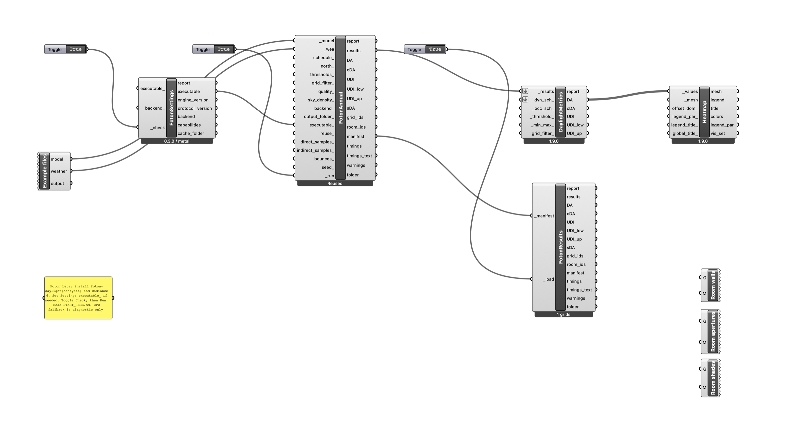
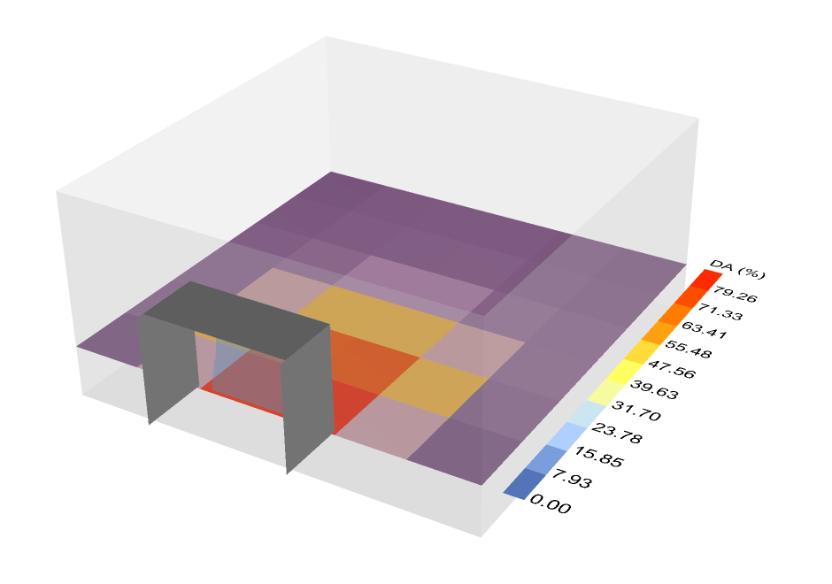

# First Foton analysis in Rhino 8

Foton is a public beta in preparation. Only hardware and scenes with published
passing release evidence should be described as validated.

## Install once

1. Install CPython 3.13 and run `python -m pip install "foton-daylight[honeybee]"`.
   That is the whole run-time requirement: the annual sky matrix is computed
   by Foton's own Perez all-weather model, so Radiance is not needed. (Radiance
   5.4a is used only to reproduce the validation evidence; if an installation
   is present, Foton Settings reports it and a run can opt into its sky.)
2. Download the versioned `foton-grasshopper-<version>.zip` release asset and extract
   the entire archive into a permanent folder. Keep `examples` beside the `.gh` file.
3. Open **Foton First Analysis.gh** in Rhino 8 Grasshopper. The components already
   contain their scripts and bridge; no script editing or module search paths are needed.
   To reuse them in other definitions, copy the three `.ghuser` files into the
   Grasshopper User Objects folder (available from Grasshopper's File / Special Folders menu).

The downloadable asset is produced only from a Rhino-generated, round-trip-tested
build matching the current component sources. If no asset is published yet, the
manual scripts in `grasshopper_foton/components` remain developer sources, not a
completed easy-install release.

## Five-minute example

1. Toggle **Check** on Foton Settings. Confirm the version, protocol, and selected
   backend. If discovery fails, connect the full `foton-honeybee` path to `executable_`.
   On Windows this is usually `Python313\Scripts\foton-honeybee.exe`, or the
   corresponding virtual environment's `Scripts` folder. On macOS use its `bin` folder.
2. Read any setup warnings. Metal or Vulkan should be selected for GPU execution.
   CPU reference fallback is usable for diagnosis but does not demonstrate GPU performance.
3. Toggle **Run** on Foton Annual Daylight. The example contains a shaded shoebox
   and Gothenburg weather. First-run weather preparation can take longer than later runs.
4. Connect `results` to **HB Annual Daylight Metrics**. Pair the original Honeybee
   SensorGrid meshes with `DA` in **LB Spatial Heatmap**; branches preserve model order.
5. Save the result folder. **Foton Annual Results** reloads its `run_manifest.json`
   without running a simulation. New result folders can be moved as a unit.

The canvas above is the shipped example plus the two Ladybug Tools components
from step 4 and three Custom Preview components for the room; Honeybee's own
metrics component returns the same DA as Foton's `DA` output because Foton
writes a standard annual-daylight results folder.

Use `quality_ = final` when evaluating accuracy; it is the preset the
[0.3.0 release evidence](release-readiness.md#tested-platforms-for-030)
validated against converged Radiance. Preview is visibly labelled. Changing
inputs, quality defaults, solver versions, backend, or sky model version invalidates
automatic reuse. Missing/corrupt metric files also cause a new run in a numbered folder.

## Troubleshooting

| Symptom | Action |
| --- | --- |
| Executable not found | Supply its full path to Settings; check `python -m pip show foton-daylight`. |
| Settings reports `gendaymtx` unavailable | Nothing to do: annual runs use Foton's built-in sky. Install Radiance 5.4a and set `RADIANCE_BIN` only to reproduce validation evidence or to opt into `gendaymtx`. |
| Reference CPU selected | Update the GPU driver and inspect backend requirements; explicit Metal/Vulkan requests report errors instead of falling back. |
| Output/cache not writable | Use a local writable output folder and inspect Settings' directory diagnostics. |
| Unsupported modifier | Use diffuse Plastic or thin Glass with refractive index 1.52; Foton reports the rejected object/modifier. |
| Cancelled or failed | Read `report`; partial output is never eligible for reuse. Retry into the automatically allocated new folder. |

Report problems with Foton Settings output, OS/Rhino/GPU versions, the error text,
and a minimal shareable model. Remove private project paths from diagnostics before posting.
