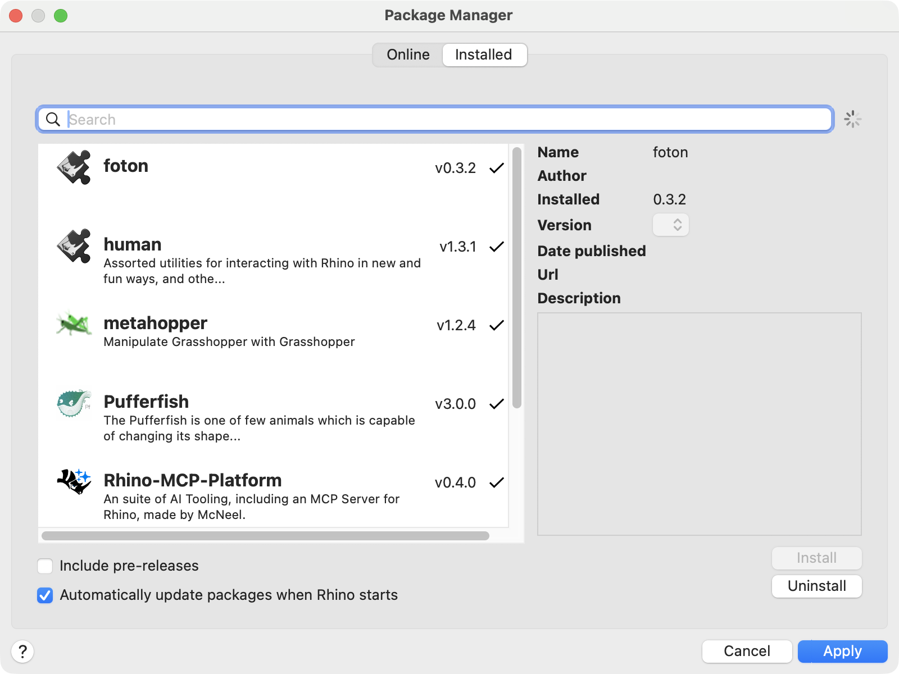

# Publishing Foton to Rhino's Package Manager

This is the maintainer checklist for putting the Foton Grasshopper components on
Rhino's Package Manager (the Yak server at https://yak.rhino3d.com). Users then
install them from inside Rhino instead of copying files by hand.

The package holds the four Foton user objects, the example definition with its
model and weather file, `LICENSE` and `NOTICE`. It does not hold Foton's Python
engine: the Foton Settings component still installs that from PyPI on first use.

## The Yak command

Rhino 8 ships the `yak` command-line tool:

- Mac: `/Applications/Rhino 8.app/Contents/Resources/bin/yak`
- Windows: `C:\Program Files\Rhino 8\System\Yak.exe`

The examples below use `yak`. On a Mac, either type the full path or make an alias:

```bash
alias yak="/Applications/Rhino 8.app/Contents/Resources/bin/yak"
```

`scripts/package_yak.py` finds it in those places, or uses the path in the `YAK`
environment variable.

## Before you start

1. The release is tagged and on PyPI. Foton Settings installs
   `foton-daylight[honeybee]` at the same minor version, so the package must not
   reach users before PyPI has the matching wheel.
2. The Grasshopper build is current: `python scripts/package_grasshopper.py`
   runs without errors. It refuses to package if the component sources changed
   after the last build in Rhino.
3. `version:` in `grasshopper_foton/yak/manifest.yml` matches `version` in
   `pyproject.toml`. `tests/python/test_package_yak.py` checks this.

## One-time setup: log in

```bash
yak login
```

This opens a browser window for your Rhino account (the same one you use for
Rhino licences). Sign in and allow access. Yak saves a token on your computer
(`~/.mcneel/yak.yml` on a Mac, `%APPDATA%\McNeel\yak.yml` on Windows), so you
only do this once per computer.

The account you push with becomes the package owner. To let someone else publish
too:

```bash
yak owner add foton their.email@example.com
```

## Build the package

From a checkout of the release tag, with Foton and its `honeybee` extra
installed in the active Python:

```bash
python scripts/package_yak.py
```

It checks the Grasshopper build, copies the package files into `dist/yak/`,
runs `yak build --platform any` there, and moves the result to `dist/`:

```text
dist/foton-0.3.2-any-any.yak
```

**Why "any-any"?** Yak names a package `<name>-<version>-<rhino>-<platform>.yak`.
It reads the Rhino version from a compiled plug-in (`.gha` or `.rhp`). Foton has
none, only Grasshopper user objects, so Yak marks it for any Rhino version
(`any`), and `--platform any` marks it for Mac and Windows. There is no manifest
setting to pin it to Rhino 8. The components need Rhino 8; the package
description says so.

## Test it locally

1. Move any Foton `.ghuser` files out of Grasshopper's User Objects folder
   (**File > Special Folders > User Object Folder**), or you will see two copies.
2. Install the file you just built:

   ```bash
   yak install dist/foton-0.3.2-any-any.yak
   ```

3. Restart Rhino and open Grasshopper. Rhino's Package Manager lists foton under
   **Installed**:

   

4. Check the four components appear on the **HB-Foton** tab and in canvas
   search (double-click the canvas and type **Foton**). In 0.3.2 they do not:
   its user objects are marked hidden, which is fixed from 0.3.3. Open the example from the package folder
   (`~/Library/Application Support/McNeel/Rhinoceros/packages/8.0/foton/<version>/`
   on a Mac, `%APPDATA%\McNeel\Rhinoceros\packages\8.0\foton\<version>\` on
   Windows) and run Check and Run on it.
5. Remove the test install and put back anything you moved in step 1:

   ```bash
   yak uninstall foton
   ```

## Dry run on the test server

McNeel runs a test server that does not appear in anyone's Package Manager.
Push there first:

```bash
yak push --source https://test.yak.rhino3d.com dist/foton-0.3.2-any-any.yak
yak search --source https://test.yak.rhino3d.com foton
```

The search should print `foton (0.3.2)`. You can also install from it to check
the download:

```bash
yak install --source https://test.yak.rhino3d.com foton 0.3.2
```

Treat the test server as temporary: McNeel can clear it at any time.

## Publish for real

```bash
yak push dist/foton-0.3.2-any-any.yak
yak search foton
```

The new version shows up in Package Manager within a few minutes. A version
number can only be pushed once: to fix a mistake, bump the version and push again.

## Withdraw a bad version

You cannot delete a version, but you can hide it ("yank" it) so Package Manager
stops offering it:

```bash
yak yank foton 0.3.2
```

People who already installed it keep it until they update. Push a fixed version
straight after, so the newest listed version works.

## Optional: publish from GitHub Actions

To let the release workflow push the package:

1. On your computer, make a token that does not expire:

   ```bash
   yak login --ci
   ```

   It prints a long API key. Treat it like a password.
2. In the GitHub repository, open **Settings > Secrets and variables > Actions**
   and add a secret named `YAK_TOKEN` with that key.
3. In the workflow job that pushes, expose it to `yak` as the `YAK_TOKEN`
   environment variable and run the same `yak push` command, after the PyPI
   publish step has succeeded. GitHub's runners do not have Rhino, so the job
   first has to download McNeel's stand-alone `yak` tool; check McNeel's Yak
   guide for its current download link.

If the key leaks, delete the `YAK_TOKEN` secret straight away and ask McNeel how
to revoke the key.
